# Nexus Company Enterprise RAG

An enterprise-grade Retrieval-Augmented Generation (RAG) system built with **LangChain**, **Google Cloud Storage**, **ChromaDB**, and **Google Vertex AI / Gemini**.

This application implements **Role-Based Access Control (RBAC)** using **Pre-Retrieval Metadata Filtering** to ensure sensitive enterprise documents (e.g., executive bonuses, client SOWs, engineering specs) are strictly isolated based on user personas.

---

## 🏛️ Architecture Overview

```mermaid
flowchart TD
    subgraph Ingestion["1. Ingestion & Storage Layer"]
        GCS["Google Cloud Storage (PDFs)"] --> Loader["GCS File Loader (PyPDFLoader)"]
        Loader --> Tagger["Metadata Persona Tagger"]
        Tagger --> Splitter["Recursive Character Text Splitter"]
        Splitter --> Embed["Vertex AI Embeddings (text-embedding-005)"]
        Embed --> Chroma[("ChromaDB (./chroma_db)")]
    end

    subgraph Retrieval["2. Hybrid Retrieval & Generation"]
        User["User Question + Persona"] --> PreFilter["Persona RBAC Filter<br/>(Allowed Categories)"]
        PreFilter --> Dense["Dense Leg: Chroma MMR (60%)"]
        PreFilter --> Sparse["Sparse Leg: BM25 Lexical (40%)"]
        Dense & Sparse --> RRF["Reciprocal Rank Fusion (RRF)"]
        RRF --> Context["Formatted Excerpts with Citations"]
        Context --> LLM["Google Gemini (gemini-3.5-flash)"]
        LLM --> Output["Grounded Answer with Page Footnotes"]
    end
```



---

## 🔒 Role-Based Access Control (RBAC)

Documents are tagged at ingestion with persona categories. Chroma filters out unauthorized chunks **before** calculating vector similarity, guaranteeing forbidden documents never enter the LLM's context window.

### Persona Permission Matrix

| User Persona | Permitted Document Categories | Example Accessible Documents |
| :--- | :--- | :--- |
| **`employee`** | `employee` | Employee Handbook, Code of Conduct, Benefits Guide, AI Usage Policy, Travel Policy |
| **`engineering`** | `engineering`, `security`, `employee` | Cloud Architecture Standards, SDLC Process, Project Specs, Incident Playbook |
| **`hr`** | `hr`, `employee` | Performance Review Policy, Employee Relations |
| **`sales`** | `sales`, `employee` | Client Onboarding Playbook, Project Client SOW |
| **`security`** | `security`, `engineering`, `employee` | InfoSec Policy, Incident Response, GDPR & Data Privacy |
| **`finance`** | `finance`, `employee` | Procurement & Vendor Policy |
| **`executive`** | **ALL** categories (unrestricted) | Compensation & Bonus Structure, Strategic Product Roadmaps, SOWs, all policies |

---

## 📁 Repository Structure

```
nexus_company_rag/
├── src/
│   ├── document_loader/          # Ingestion from GCS & persona tagging
│   │   ├── __init__.py
│   │   └── gcs_file_loader.py
│   ├── document_chunker/         # Text splitting & JSONL upload
│   │   ├── __init__.py
│   │   └── recursive_text_splitter.py
│   ├── document_embedder/        # Chroma vector database & persistence
│   │   ├── __init__.py
│   │   └── chroma_store.py
│   └── document_retriever/       # MMR retriever & grounded LLM generation
│       ├── __init__.py
│       └── rag_retriever.py
├── requirements.txt              # Pinned Python dependencies
├── .env.example                  # Environment configuration template
├── .gitignore                    # Git ignore file
└── README.md                     # Documentation
```

---

## 🚀 Getting Started

### 1. Prerequisites
- Python 3.10+
- Google Cloud SDK (`gcloud`) authenticated:
  ```bash
  gcloud auth application-default login
  gcloud config set project poc-data-analytics-501104
  ```

### 2. Installation
Create and activate a virtual environment:
```bash
python3 -m venv .venv
source .venv/bin/activate
pip install -r requirements.txt
```

### 3. Environment Configuration
Copy the sample environment file:
```bash
cp .env.example .env
```

---

## 💻 Usage

### 1. Build / Re-index the Vector Database
Download PDFs from GCS, attach persona metadata, chunk, and persist to `./chroma_db`:
```bash
python src/document_embedder/chroma_store.py --reindex
```

### 2. Query with Hybrid Search & Persona Filtering

#### Query Technical Specs / Project Codename (Hybrid Search):
```bash
python src/document_retriever/rag_retriever.py "What are the objectives of Project Aegis?" --persona engineering --mode hybrid
```

#### Query as a Standard Employee (Dense + BM25 RBAC enforced):
```bash
python src/document_retriever/rag_retriever.py "how much is performance bonus?" --persona employee --mode hybrid
```
*Output: Both BM25 and Chroma filter out executive compensation documents. The LLM responds that it does not have enough information.*

#### Query as an Executive:
```bash
python src/document_retriever/rag_retriever.py "how much is performance bonus?" --persona executive --mode hybrid
```
*Output: Retrieves the confidential compensation table and generates the exact figures with citations.*

---

## 🛡️ Security Best Practices
- **No Prompt-Based Security**: RBAC is enforced strictly at the database level (`where={"persona": {"$in": ...}}`), preventing prompt-injection attacks.
- **Zero Local Vector DB Commits**: `chroma_db/` and credential files are gitignored.
- **Deterministic Citations**: Answers strictly reference source documents and page numbers.

